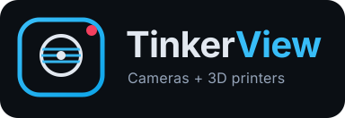
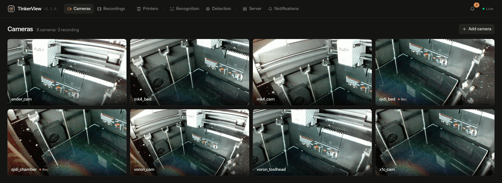
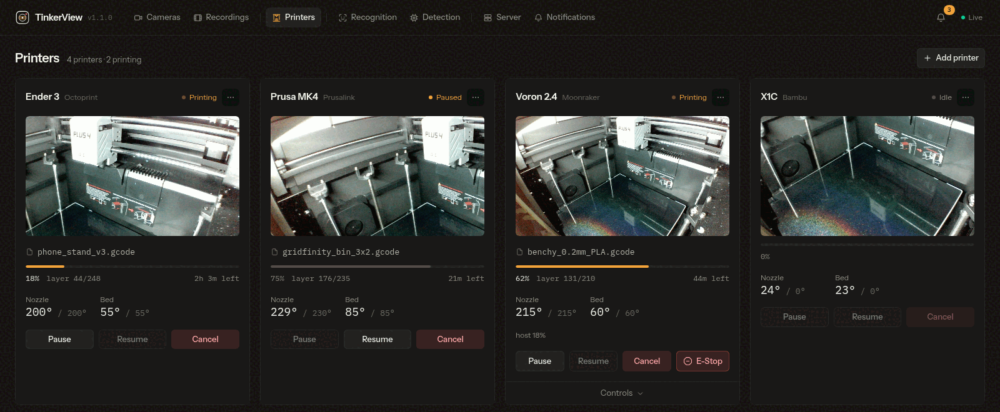
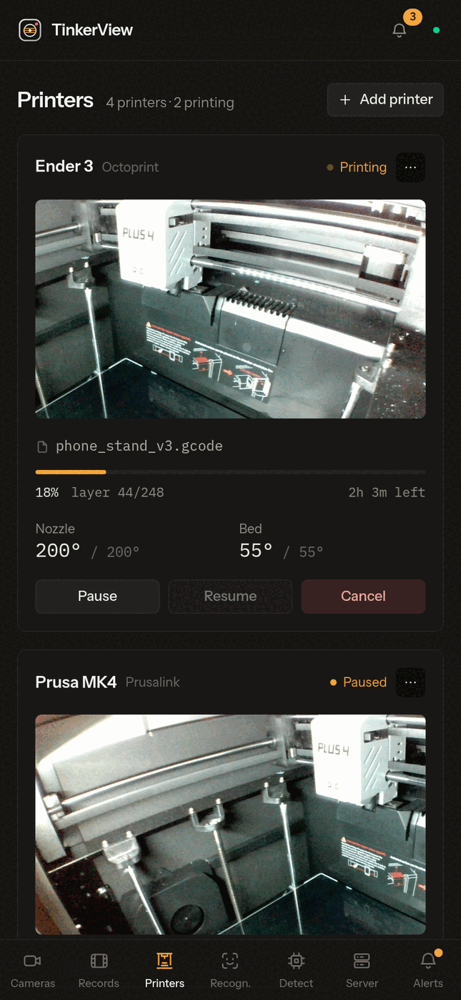
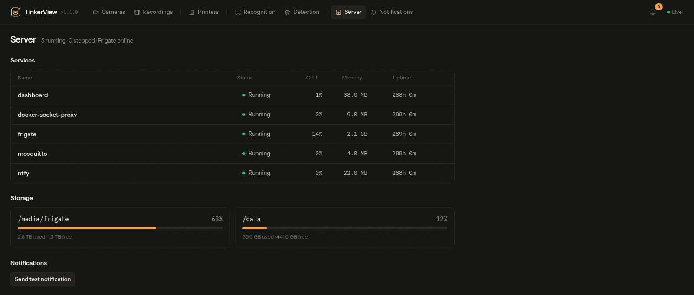

<!-- SPDX-License-Identifier: AGPL-3.0-only -->

<p align="center">
  
</p>

<p align="center">
  <strong>One self-hosted pane for your cameras and your 3D printers.</strong><br>
  Frigate and go2rtc for the video, a small Go and React dashboard on top, and one command to install it.
</p>

<p align="center">
  <a href="https://github.com/MakerViking/TinkerView/actions/workflows/ci.yml"></a>
  <a href="https://github.com/MakerViking/TinkerView/releases"></a>
  
  
</p>

<p align="center">
  <br>
  <sub>The camera wall (demo data and a looping test video).</sub>
</p>

Printer cameras are often cheap MJPEG streams that allow one viewer at a time, and
security cameras want RTSP, an NVR and a detector. TinkerView puts both on one screen.
[Frigate](https://frigate.video) and its bundled go2rtc open **one connection per
camera** and fan it out to as many viewers as you like. A single dashboard binary adds
the printers, the server health and the alerts.

It is a Docker Compose stack plus an installer that picks the right setup for your
hardware. It runs on a NAS or a small Linux box on your own network. Part of [TinkerAtlas](https://tinkeratlas.com).

- **A live camera wall** over low-latency WebRTC, with recording state and a per-tile menu (copy the RTSP or player URL, HQ, fullscreen)
- **GPU "HQ" mode** per tile: denoise, sharpen and upscale a weak camera on an Nvidia encoder, only while you watch it
- **Printers in the same view**: Klipper/Moonraker, OctoPrint, PrusaLink and Bambu Lab, with temperatures, progress, files, history and pause, resume and cancel
- **Add and edit cameras and printers in the UI**, with no config file required to start
- **NVR through Frigate**: tiered retention, object detection, face and licence-plate recognition, a recordings browser
- **Detection hardware picker** and presets for Nvidia, Intel, AMD, Raspberry Pi, Coral and plain CPU
- **Push alerts through ntfy** (print completion, detections), with rules you edit in the UI
- **Server health**: container status and restart, and recording-disk usage
- **Home Assistant** through the standard Frigate and MQTT integrations
- **One small image**: a distroless, non-root container, multi-arch (amd64 and arm64)

<p align="center">
  <strong>v1.1.0. Daily use on one Nvidia setup; other hardware presets are untested.</strong><br>
  <sub>The <a href="#status">Status</a> section says exactly what has been run and what has not.
  The dashboard has no user accounts: read <a href="#security">Security</a> before you
  put it on a network you do not fully trust.</sub>
</p>

<p align="center">
  <a href="#why-tinkerview">Why TinkerView</a> ·
  <a href="#status">Status</a> ·
  <a href="#get-it">Get it</a> ·
  <a href="#updating">Updating</a> ·
  <a href="#configuration">Configuration</a> ·
  <a href="#security">Security</a><br>
  <a href="#troubleshooting">Troubleshooting</a> ·
  <a href="#how-it-fits-together">How it fits together</a> ·
  <a href="#checking-it">Checking it</a> ·
  <a href="#ai-assistance">AI assistance</a> ·
  <a href="#layout">Layout</a> ·
  <a href="#documentation">Docs</a> ·
  <a href="#licensing">Licensing</a> ·
  <a href="#support">Support</a>
</p>

## Why TinkerView

1. **Cameras that allow one viewer stop being a problem.** go2rtc holds the single
   upstream connection and serves everyone else from it, so a printer camera can be on
   the wall, in a second tab and in the printer's own UI at once.
2. **Printers and cameras share a screen.** A print's camera, progress and controls sit
   together, and the same alerts cover both.
3. **It installs itself.** `install.sh` detects your hardware, writes the right
   Frigate preset, creates `.env` and the data folders with the right owner, and starts
   the stack. There are also paths for Unraid, CasaOS and a dashboard-only container.
4. **It stays on your network.** No account and no cloud service of mine. Remote
   access is a Tailscale sidecar you opt into, not an open port. (Frigate and ntfy have
   their own outbound behaviour; see [SECURITY.md](SECURITY.md) and
   [docs/CONFIGURATION.md](docs/CONFIGURATION.md#ntfy-and-ntfysh).)
5. **You can read it.** AGPL-3.0, one Go module, one React app, and
   [SECURITY.md](SECURITY.md) lists every port and what protects it.

## Status

**v1.1.0, used daily on one setup.** Since mid-2026 the full stack has run on my own
Unraid server with an Nvidia GPU: the `nvidia` preset, NVENC "HQ" streams, a mix of RTSP
and MJPEG cameras, and Moonraker, OctoPrint, PrusaLink and Bambu printers.

**Proven:**

- the full stack on Unraid with an Nvidia GPU, day to day
- the dashboard, its API and its adapters under the test suite and CI gates in
  [Checking it](#checking-it)
- a CasaOS first-run bug (the data folder was created as root) found and fixed
- `install.sh` against a stand-in `docker` command, and every compose overlay
  combination for syntax and merging

**Tested on a clean machine:**

- A fresh install on a Linux workstation with rootless podman 6.1 and the standalone
  docker-compose 5.6, no TinkerView state on it: `./install.sh --yes --preset cpu --build`,
  then the dashboard, Frigate, go2rtc, Mosquitto, ntfy and the docker-socket-proxy all came
  up, the dashboard showed Frigate online and the container list, and a camera added through
  the UI restreamed. The same stack also ran with `compose.bridge.yml`. This used the CPU
  preset and a dashboard image built from the checkout. I did not test the prebuilt
  `ghcr.io` image path, Docker Engine proper, or any GPU preset there.
- The installer picks the prebuilt image only when it can pull the matching `1.1.0` tag
  without logging in; otherwise it builds from the checkout. Until that image is published,
  `--build` is what actually gets used and tested.

**Not run on real hardware:**

- the `intel`, `amd-rocm`, `pi` and `coral` presets
- SELinux hosts (Fedora, RHEL): `compose.selinux.yml` and the installer's detection are
  written but I have not run them on one
- rootless Docker and Docker Desktop socket detection in the installer (read, not run)
- `compose.bridge.yml` on Windows with Docker Desktop (it has run on Linux under podman)
- the Unraid dashboard-only template and the Compose Manager wrapper, and the CasaOS
  import route (the steps in [unraid/](unraid/README.md) and [casaos/](casaos/README.md)
  are the expected path, not a recording of one)

**Known issues:**

- A WebRTC camera tile can occasionally stall. The dashboard notices and reconnects it
  by itself after about 15 seconds. The root cause is still under investigation.
- Frigate and go2rtc ports (5000, 1984) have no authentication of their own, so on a
  shared LAN they need a firewall (see [Security](#security)).

<p align="center">
  <br>
  <sub>Four printer brands side by side (demo data).</sub>
</p>

## Get it

You need a Linux machine (or a NAS) with Docker and Docker Compose v2, and the camera
URLs you want to watch. Rootless Podman with `docker-compose` also works (it is what I
tested the clean install on); see [docs/INSTALL.md](docs/INSTALL.md#podman). Pick one
path.

### 1. The installer (recommended)

```sh
git clone https://github.com/MakerViking/TinkerView.git
cd TinkerView
./install.sh --dry-run     # shows what it would do, changes nothing
./install.sh               # guided
```

The installer detects your GPU, suggests a preset, asks before it changes or starts
anything, and prints the exact `docker compose` command it used. It creates `.env` (mode
600), generates a dashboard token, writes the matching detector block into
`frigate/config.yml`, creates the data folders with the owner the dashboard needs and
waits for `http://127.0.0.1:8088/healthz`. Re-running is safe: it backs up what it
changes to `storage/install-backups/`.

Unattended, with a safe first boot: `./install.sh --yes --preset cpu`. Every option is
in `./install.sh --help` and in [docs/INSTALL.md](docs/INSTALL.md).

Then open **`http://<host>:8088`**. If the installer generated a token it prints a link
ending in `/?token=...`; open that once and the browser remembers it.

### 2. Docker Compose by hand

```sh
git clone https://github.com/MakerViking/TinkerView.git && cd TinkerView
cp .env.example .env                                 # edit TZ, STORAGE_PATH, camera credentials
openssl rand -hex 24                                 # put the output in DASHBOARD_TOKEN in .env
mkdir -p dashboard/data && chown 65532:65532 dashboard/data   # the dashboard runs as uid 65532
# paste your host preset into the HOST-SPECIFIC block of frigate/config.yml
docker compose -f docker-compose.yml -f compose.cpu.yml up -d
```

Without a `DASHBOARD_TOKEN`, anyone on your network can use the dashboard, so set one
before the first start (the installer does it for you). Swap `compose.cpu.yml` for `compose.nvidia.yml`, `compose.intel.yml`,
`compose.amd-rocm.yml` or `compose.pi.yml`. Stack `-f compose.coral.yml` for a Coral
accelerator. Start with `cpu` to confirm cameras connect, then move to your real
hardware. Which preset fits which hardware is in
[`frigate/host-presets/README.md`](frigate/host-presets/README.md).

### 3. Unraid

Unraid has no native Compose, so install **Docker Compose Manager** from the Apps tab,
download a release into `/mnt/user/appdata/tinkerview` and run `bash install.sh` there.
There is also a template for running only the dashboard next to a Frigate you already
have. Step by step, with GPU driver notes: [unraid/README.md](unraid/README.md).

### 4. CasaOS

Run the installer over SSH in `/DATA/AppData/tinkerview`, or merge the compose files and
use CasaOS's custom install. [casaos/README.md](casaos/README.md) has both.

### 5. Dashboard only

Already running Frigate and go2rtc? Run just the dashboard from
`ghcr.io/makerviking/tinkerview:latest` on the host network, with a data folder owned by
uid 65532 mounted at `/data`, and point `data/config.yaml` at your Frigate. The
container command and the settings are in
[docs/INSTALL.md](docs/INSTALL.md#dashboard-only).

### First steps

1. In `frigate/config.yml`, point the example `front_door` and `printer1` go2rtc streams
   at your real cameras and set each camera's `enabled:` to `true`. They ship disabled
   on purpose. Put camera credentials in `.env` (`FRIGATE_RTSP_USER`,
   `FRIGATE_RTSP_PASSWORD`). Then `docker compose restart frigate`.
2. Add printers and extra cameras from the dashboard (**Add printer** on the Printers
   tab, **Add camera** on the Cameras tab).
3. Set up push alerts (Notifications tab): [docs/CONFIGURATION.md](docs/CONFIGURATION.md#notifications-ntfy).

Camera preparation (H.264 main stream, substream for detection, which codecs to avoid) is
in [docs/CAMERAS.md](docs/CAMERAS.md).

## Updating

Your settings and recordings live in `.env`, `dashboard/data/`, `frigate/`, `ntfy/` and
`STORAGE_PATH`, none of which an update touches.

```sh
git pull                                                  # new compose files, presets, docs
docker compose build dashboard && docker compose up -d    # dashboard built from source (the default)
docker compose pull && docker compose up -d               # only if DASHBOARD_IMAGE in .env is the ghcr.io image
```

Which one applies depends on `DASHBOARD_IMAGE` in `.env`: `tinkerview:latest` is built
locally and cannot be pulled; `ghcr.io/makerviking/tinkerview:latest` is pulled.

`install.sh` records your overlay files in `.env` as `COMPOSE_FILE`, so plain `docker
compose` works from the folder. If you started by hand, repeat your `-f` flags. The
running version shows in the dashboard header and at `GET /api/version`. Details, and
what changed between versions: [docs/UPGRADING.md](docs/UPGRADING.md) and
[CHANGELOG.md](CHANGELOG.md).

## Configuration

Most things are set from the dashboard itself. The rest live in three places:

| What | Where |
|---|---|
| Secrets, images, ports, storage path, timezone | `.env` (copy of `.env.example`) |
| Cameras, go2rtc streams, retention, detector | `frigate/config.yml` |
| Dashboard settings and UI-added printers and cameras | `dashboard/data/config.yaml` and `dashboard/data/devices.yaml` |

The dashboard reads these environment variables: `DASHBOARD_TOKEN`, `DASHBOARD_LISTEN`,
`DASHBOARD_LOG_LEVEL`, `DASHBOARD_WS_ORIGINS`, `DOCKER_HOST`, `NTFY_BASE_URL` and
`NTFY_TOKEN`. The full reference, with every `.env` variable, the YAML options, MQTT for
Home Assistant, Tailscale and Obico, is in
[docs/CONFIGURATION.md](docs/CONFIGURATION.md) and
[docs/INTEGRATIONS.md](docs/INTEGRATIONS.md).

<p align="center">
  <br>
  <sub>The same dashboard on a phone.</sub>
</p>

## Security

TinkerView is an appliance for a network you control: a home LAN or a tailnet. It is not
hardened for the open internet. **Do not forward its ports from your router.**

- **The dashboard has no accounts.** Anyone who can reach port 8088 can see the cameras
  and control the printers. Set a shared token: `openssl rand -hex 24` into
  `DASHBOARD_TOKEN` in `.env` (the installer does this for you), recreate the dashboard,
  and open `http://<host>:8088/?token=<token>` once. Without a token the dashboard logs
  a warning at every start.
- **MQTT is on loopback.** Mosquitto's anonymous port 1883 is published on `127.0.0.1`
  only. Home Assistant on another machine uses the password-protected port 1884 from
  `compose.mqtt-lan.yml`.
- **Frigate (5000) and go2rtc (1984) are unauthenticated** and, in host-network mode,
  reachable from your LAN. Firewall them to machines you trust.
- **`GO2RTC_ALLOW_ARBITRARY_EXEC` is `false` by default.** The GPU "HQ" streams need
  `true`. While it is true, anyone who can reach port 1984 can run commands inside the
  Frigate container. Turn it on only behind a firewall.
- **Docker access goes through docker-socket-proxy**, bound to `127.0.0.1:2375` and
  **read-only by default**: the container panel shows health and the Restart button is
  disabled. Setting `DOCKERPROXY_POST=1` in `.env` turns the button on, but that proxy
  setting also permits creating containers, which is root-equivalent for anything that can
  reach that port.
- **Frigate only receives the variables it needs** (camera credentials, timezone, the
  go2rtc exec switch, the LAN IP), not the whole `.env`, so your dashboard token and
  Tailscale key are not in its environment.
- **One outbound call by default:** ntfy relays a content-free poll request to `ntfy.sh`
  so iOS gets instant push. Set `NTFY_UPSTREAM_BASE_URL=` (empty) in `.env` if you do
  not use iOS. Frigate has its own update check; see `telemetry:` in its documentation
  if you want it off.
- **Credentials you enter** (printer API keys, Bambu access codes, camera passwords) are
  stored in plain text under `dashboard/data/` and, for promoted cameras, in
  `frigate/config.yml`. Protect those folders and any backups.

[SECURITY.md](SECURITY.md) has the full port table, the hardening checklist and the
private way to report a vulnerability.

## Troubleshooting

The ones people hit first. [docs/TROUBLESHOOTING.md](docs/TROUBLESHOOTING.md) has the rest.

- **Frigate restarts with `[Errno 98] ... ('127.0.0.1', 5001)`.** Another process on the
  host already owns a port Frigate needs (5000, 5001, 1984, 8554 or 8555). Find it with
  `ss -lntp | grep :5001`, stop it, or add `compose.bridge.yml`.
- **`Unable to read frames from ffmpeg process` on a fresh install.** A demo camera was
  enabled before its go2rtc stream pointed at a real camera. Fix the URL or set
  `enabled: false`.
- **The dashboard cannot save printers or cameras.** `dashboard/data` is not owned by
  uid 65532: `sudo chown 65532:65532 dashboard/data` (without `-R`, so `config.yaml`
  stays editable by you).
- **Black camera tiles.** An H.265 or "smart codec" stream. Use the plain H.264
  substream for live view.
- **A tile freezes.** It reconnects by itself after about 15 seconds; reload the tab if
  it does not. This is the known issue under [Status](#status).

## How it fits together

<p align="center">
  <br>
  <sub>The Server view, with a docker-socket-proxy attached.</sub>
</p>

```
 cameras (RTSP / MJPEG) ──> Frigate + go2rtc ──> recordings, detection, restream :8554, WebRTC :8555
 printers (Moonraker, OctoPrint, PrusaLink, Bambu) ─┐
                                                    ├──> dashboard :8088 ──> browser
 Frigate events <── MQTT (Mosquitto :1883) ─────────┤                    └──> ntfy :8092 ──> phone
 docker-socket-proxy :2375 ─────────────────────────┘
```

- **Frigate** runs the NVR, the detector and go2rtc. It uses host networking so WebRTC
  works without extra configuration.
- **The dashboard** is one Go binary that embeds the React app. It talks to Frigate,
  go2rtc, the printers and Docker, and pushes everything to the browser over one
  WebSocket. It proxies camera video, so the browser only ever talks to port 8088.
- **Mosquitto** carries Frigate's events to the dashboard and to Home Assistant.
- **ntfy** delivers push notifications. **docker-socket-proxy** gives the dashboard
  read access (and, optionally, restart) to Docker without handing it the socket.
- **Tailscale** is an optional sidecar that publishes only the dashboard on your tailnet.

More detail: [docs/ARCHITECTURE.md](docs/ARCHITECTURE.md).

## Checking it

From `dashboard/` (Go 1.25 or newer):

```sh
go vet ./... && go test -race ./...
```

From `dashboard/web/` (Node 22):

```sh
npm ci && npm run typecheck && npm run build
```

On every push and pull request, CI runs `gofmt`, a `go mod tidy` diff check, `go vet`,
`go test -race`, `npm ci`, `tsc --noEmit`, `vite build`, `docker compose config` for every
overlay combination, and a no-push build of the dashboard image. Releases are built for
amd64 and arm64 by a separate workflow on `v*` tags. All GitHub Actions are pinned to
full commit SHAs. `./dashboard/run-local.sh` serves the UI in demo mode on
`http://127.0.0.1:8088` without any cameras or printers.

## AI assistance

I build this with AI assistance. Code, tests, docs.

I direct it and review what comes out. Every change passes the same gates whatever wrote
it: `gofmt`, `go vet`, `go test -race`, `tsc`, the production build, and the compose and
image checks in CI. Anything that touches a camera, a printer or the stack is tried on
the running setup before it counts as working, and the [Status](#status) section keeps
"run on hardware" separate from "tested".

The reasoning lives in the repo rather than in my head. Commit messages record what was
tried and why, and [`docs/`](docs/) carries the design. Judge it on that.

## Layout

```
docker-compose.yml     base stack: Frigate, Mosquitto, dashboard, ntfy, docker-socket-proxy
compose.<preset>.yml   hardware overlays: nvidia, intel, amd-rocm, cpu, pi, coral
compose.bridge.yml     published ports instead of host networking
compose.mqtt-lan.yml   password-protected MQTT for other machines
compose.tailscale.yml  Tailscale sidecar for the dashboard
compose.selinux.yml    label=disable for SELinux Enforcing hosts (untested)
compose.obico.yml      notes for optional print-failure detection
install.sh             the installer
.env.example           copy to .env
frigate/               config.yml and host-presets/ (detector and decode blocks)
dashboard/             the Go service (cmd/, internal/) and the React app (web/)
mosquitto/             broker config
unraid/  casaos/       platform guides, plus the Unraid dashboard template
tailscale/             Serve config for the sidecar
docs/                  install, configuration, upgrading, troubleshooting, architecture
```

## Documentation

- [INSTALL.md](docs/INSTALL.md): installer options, manual setup, bridge networking, dashboard only
- [CONFIGURATION.md](docs/CONFIGURATION.md): `.env`, `config.yaml`, Frigate config, notifications
- [CAMERAS.md](docs/CAMERAS.md): camera inventory, codec preparation, GPU "HQ" streams
- [INTEGRATIONS.md](docs/INTEGRATIONS.md): Home Assistant, Tailscale, Obico, Caddy
- [UPGRADING.md](docs/UPGRADING.md): updating and migrating between versions
- [TROUBLESHOOTING.md](docs/TROUBLESHOOTING.md): symptoms and fixes
- [ARCHITECTURE.md](docs/ARCHITECTURE.md): services, ports, data layout, the dashboard's internals
- [unraid/README.md](unraid/README.md) and [casaos/README.md](casaos/README.md): platform guides
- [`frigate/host-presets/README.md`](frigate/host-presets/README.md): which preset for which hardware
- [SECURITY.md](SECURITY.md) and [CHANGELOG.md](CHANGELOG.md)

## Licensing

TinkerView is licensed under the GNU Affero General Public License v3.0
(`AGPL-3.0-only`); see [LICENSE](LICENSE). Third-party components and their licences are
listed in [NOTICE.md](NOTICE.md).

- Running TinkerView on your own network is **not** distribution. The AGPL's source
  obligation applies only if you hand the software to someone else, or offer a modified
  version to others over a network.
- Contributions come in under the AGPL, with a short grant that lets the maintainer also
  offer commercial terms; see [CONTRIBUTING.md](CONTRIBUTING.md).
- This is how the project treats its material, not legal advice.

### Trademarks and non-affiliation

TinkerView is an independent project. It is **not affiliated with, endorsed by, or
sponsored by** the owners of any product it works with. Frigate, go2rtc, Moonraker,
Klipper, Mainsail, Fluidd, OctoPrint, PrusaLink and Prusa, Bambu Lab, Unraid, CasaOS,
Home Assistant, Tailscale, ntfy, Mosquitto, Nvidia, Intel, AMD, Raspberry Pi, Google
Coral and the other names mentioned here belong to their respective owners and are used
only to say what TinkerView works with.

## Contributing, security, and conduct

- [CONTRIBUTING.md](CONTRIBUTING.md): how to propose changes, the checks a pull request must pass, and the contributor grant
- [SECURITY.md](SECURITY.md): the trust model and how to report a vulnerability privately, rather than in the issue tracker
- [CODE_OF_CONDUCT.md](CODE_OF_CONDUCT.md): expected community behaviour

Please use the issue tracker for bugs and questions. Include your preset, the compose
command you ran and the output of `docker compose logs --tail 100 frigate dashboard`
with credentials removed.

## Support

TinkerView is free and open source. If you would like to back its development, the money
covers the servers, domains, and tooling behind this and my other projects.

- [PayPal](https://paypal.me/makerviking), what most people pick
- [Ko-fi](https://ko-fi.com/tinkeratlas)
- [TinkerAtlas+](https://tinkeratlas.com/pricing), a monthly plan on the site

You can also back it on [Patreon (MuninWorks)](https://www.patreon.com/MuninWorks).
